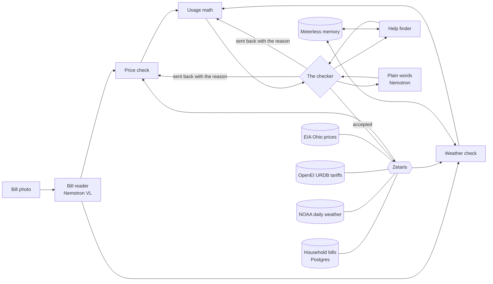

# Why So High

Snap your electricity bill. Why So High tells you why it went up and what you can do about it this month.

Built for the Open Agent Hackathon 2026, Track 03 (Reasoning Architecture). Scope: AEP Ohio residential customers in Columbus, Ohio.

## Zetaris Demo Challenge

This repository is the Zetaris Demo Challenge version of Why So High. The hackathon submission stays unchanged at [github.com/kasbsquall/whysohigh](https://github.com/kasbsquall/whysohigh); this copy adds the work done for the challenge on Oct 29, 2026:

- **A semantic layer and a data-quality rule built by Cursor's agent on SpaceXAI's Grok 4.7.** [zetaris/billing_usl.sql](zetaris/billing_usl.sql) is the file the agent wrote and ran: the `billing` USL with `household` and `bill_weather`, and the rules `weather_covers_bill` (`weather_days = days`) and `billing_days_normal`. The prompt it was given is [zetaris/prompts/task-1-lean.md](zetaris/prompts/task-1-lean.md). Its terminal at the end of the session and the Zetaris query history of each statement it ran (ids 37912d69, a86056a2, 888e89d2, 5d3faf24, 346f59a1, 49c2052a) are in [zetaris/agent-sessions/](zetaris/agent-sessions/). The agent also read our own probe script, `scripts/_probe-usl.ts`, during the session. Cursor's weekly usage limit stopped it while it wrote its report, after every statement had run.
- **The app reads that layer and rule.** The checker asks Zetaris for `weather_covers_bill` before it splits a bill, and holds a bill whose weather NOAA has not finished publishing (Marcus's October bill: 29 of 30 days). See `src/zetaris/quality.ts` and `src/held.ts`.
- **One statement, four sources.** [zetaris/four_sources.sql](zetaris/four_sources.sql) joins Linda's bills in Postgres (JDBC) with NOAA daily weather, the AEP Ohio tariff from OpenEI URDB and Ohio's average price from EIA (REST). It was written with Claude Code.
- **A safe SQL entry point for coding agents:** `npm run zsql -- "<statement>"`, `--file`, `--dry-run` and `--history <id>` to read Zetaris's own query history (`cli/zsql.ts`, rules in [AGENTS.md](AGENTS.md)).

**Demo video (2:50):** https://youtu.be/1CA6gYeeOUw

**Try it in the browser, no install:** https://kasbsquall.github.io/whysohigh/ (sample mode: the page replays the recorded live run; reading your own photo needs the live models)


Linda's bill went up $47.30. The bill says how much, not why. Why So High reads the bill, recomputes it from AEP Ohio's published tariff, joins her bills with NOAA's daily weather for Columbus, and splits the change into price, billing days, weather and her own use. A checker recomputes every number and sends work back when it does not add up. Then it says what she can do this month, with an amount: PIPP Plus could hold her bill near $100 a month, and the checker confirmed she is under its income limit. Every number on the page traces to a SQL query, a tariff line or a model call.

The household and its bills are synthetic, made from the published tariff.

## Check it in two minutes, no keys

Requires Node 22. With no `.env`, everything replays a recorded live run (`samples/cache/`): same code, same answers, no network.

```bash
npm install
npm run demo          # Linda's two months, from an empty memory; results in out/demo/
npm run eval          # the agents against 30 synthetic households and three baselines
npm test              # unit tests
npm run web:build && npm run serve   # the page on http://127.0.0.1:8787
npm run web:static    # the same page as static files in web/dist-static, for any static host
```

What to look for:

- `out/demo/month1.json`: the split of the $47.30 (`change.decomposition`), the checker's rejection of the first split and acceptance of the second (`change.verdicts`), the plain-words summary and its number check (`words`), and the decision written back through Zetaris (`recorded`).
- `logs/<run id>.jsonl`: one line per step, SQL statement, model call (with its Meterless receipt) and verdict.
- `eval/results/summary.json`: the numbers in the Evaluation section below.

## Who it is for, and who would pay

Linda (illustrative) is 71, retired and lives alone in Columbus on 24,000 USD a year. When her bill jumps she wants to know whether something is wrong and whether there is help. Finding out today means calling AEP Ohio, reading a tariff filing, or asking her local energy assistance agency.

The people who would put this in front of her are the ones who already take those calls: Ohio's local energy assistance agencies that sign households up for HEAP and PIPP Plus (the state routes applicants to them through (800) 282-0880), and the utility's own customer service. For them it answers the first question of every high-bill call with evidence, and it ends with the program the household qualifies for, already checked. We have not talked to any of them yet; this is the plan, not a result.

## How a run reasons

Two steps use a model. Everything between them is code that the checker can verify against public data.

| Step | On the page | In the code | Model or code |
|---|---|---|---|
| Read the bill photo into fields | Bill reader | `BillReader` | Nemotron 3.5 Super VL through Nightshift |
| Join the bills with NOAA daily weather, fit the household's weather model | Weather check | `WeatherAnalyst` | Code, one federated Zetaris query |
| Recompute the bill from the published tariff | Price check | `RateAnalyst` | Code, tariffs from OpenEI URDB through Zetaris |
| Split the change into price, days, weather, own use | Usage math | `UsageAnalyst` | Code |
| Recompute everything, reject and send work back | The checker | `ReconciliationCritic` | Code, six checks |
| Programs the household qualifies for, with amounts | Help finder | `ActionPlanner` | Code, rules from ODJFS, PUCO and AEP Ohio |
| What the household told us, used next month | Your notes | `HouseholdMemory` | Meterless H-MEM and World Model |
| The summary in plain words | Plain words | `Explainer` | Nemotron through Nightshift, every number checked |



The six checks:

1. **The bill matches the tariff.** The published tariff must give within 2% of the billed total. If not, the price check tries again prorating across tariff versions; if that still misses, the run reports a possible billing error with the amount.
2. **The change adds up.** What stays unexplained must be under 5% of the change (at least 1 USD). If not, the split goes back and the weather model is calibrated to the household's previous bill.
3. **The weather model is believable.** Base use above zero, slopes between 0 and 4 times the Ohio ones, and a fit that explains at least half of past bills.
4. **The household can take the action.** Income under 175% of the federal poverty guidelines for its size, the program open on the bill's date, and each crisis program's extra condition. A missing fact rejects the program instead of guessing.
5. **The data covers every day.** Tariff and weather cover every day of both bills.
6. **The summary uses only these numbers.** Every number in Nemotron's sentences must come from the split, to the cent; the sentences must name the biggest reason and may not stop mid-sentence. A failure goes back once, then falls back to a sentence built from the numbers.

What the checks prove, and what they do not: the first closure check tests whether the weather model fits the household. After calibration to the previous bill the kWh add up by construction, so the second pass only confirms the bookkeeping, and the split between weather and own use rests on check 3. On Linda's September bill the first split left $12.60 unexplained and was sent back. Over the evaluation, removing that second pass more than doubles the error (5.89 to 13.95 USD), and the checker caught 5 of 6 planted billing errors with no false alarm.


## Try your own bill

**From a photo.** On the page, "Read your own bill" sends a photo to `POST /api/photo`. BillReader reads it with Nemotron and the same agents explain it, and the result lists every check with its verdict; the photo is deleted once it is read. Reading a new photo needs the live stack (below), and the dialog says so before the first click when it is not there. "Try a sample photo" works everywhere: it replays a recorded reading of a simulated phone photo of a test bill (`web/public/sample-photo.jpg`).

**From the numbers on the bill.** No keys needed. Write the numbers printed on an AEP Ohio residential bill into a request like `input_examples/example_1.json`:

```bash
npm run explain -- --input input_examples/example_1.json
curl -X POST http://127.0.0.1:8787/api/run -H "Content-Type: application/json" -d @input_examples/example_1.json
```

A request has three parts. `household` holds what the action plan needs (`householdSize`, `annualIncomeUsd`, `electricHeat`, `oldestMemberAge`, `disconnectionNotice`; all optional, and a missing fact rejects the programs that need it). `bill.fields` holds the bill as printed: `period_start` and `period_end` (MM/DD/YYYY), `days`, `kwh`, `total_usd`, and the previous period's `prev_kwh`, `prev_days` and `prev_total_usd`. `history` is optional: earlier bills as `period_start`, `period_end` and `kwh`; with 6 or more, the weather model is fitted to the household instead of the Ohio average. Dates start on 1 Jan 2024, where the weather and tariff data start; each period is 1 to 62 days; up to 36 earlier bills, oldest first, not overlapping. The answer is JSON with `status`, the explanation under `output` and the trace under `log_file`. A request the agents cannot use gets HTTP 400 with the reason.

| Request | What happens |
|---|---|
| `example_1.json` | A gas-heated home that used 20% more than its weather response. The checker rejects the first split, the model is calibrated to the previous bill, and the second split closes. |
| `example_2.json` | An electric-heated home whose spring bill crosses the 10 Apr 2026 tariff change. 2.06 USD of the change stays unexplained and is reported as such. |
| `example_3.json` | A winter bill 18.40 USD above the published tariff, with no earlier bills. Flagged as a possible billing error with the amount. |

Their outputs and traces are in `output_examples/`. In sample mode, a request that was never recorded computes its weather join from a saved copy of the same NOAA table (`data/snapshot/`, weather up to 18 Oct 2026) and the trace marks it `"source":"snapshot"`.

## Run it live

1. Copy `.env.example` to `.env`, set `SAMPLE_MODE=false` and fill in the Meterless Nightshift runtime token, the local Zetaris password, a long random `HOUSEHOLD_DB_PASSWORD` and, ideally, a free EIA API key (`DEMO_KEY` works but EIA limits it to a few dozen calls an hour).
2. Start the household database on the Zetaris network: `npm run db:up`. It has no port on the host.
3. Register the sources in Zetaris (NOAA daily weather, OpenEI URDB tariffs, EIA retail prices, and the household Postgres with its `households`, `bills` and `decisions` tables): `npm run setup:sources`.
4. Check the stack: `npm run doctor`.

If the Nemotron vision endpoint fails, BillReader reads the bill's text layer (`<bill>.txt`) with a Nemotron text model and logs a `fallback_text` step; without a text layer it stops with the error. Provider failures are recorded with the samples, so sample mode replays the same path. With `RECORD_SAMPLES=true` a live run records what sample mode replays.

## Memory

Two Meterless engines, vendored in `engines/` and declared in `engines/VENDORED.md`, keep the household's memory in `.memory/<household id>/`.

- H-MEM keeps what happened in words: each bill's diagnosis and what the household tells us, tagged with the bill period it is about. Its clock is the bill's date, so replays give the same state.
- World Model keeps the household graph with provenance on every write: household, AEP Ohio (EIA 14006), the tariff versions it was billed under, NOAA station USW00014821, and each bill with its diagnosis.

Memory changes the outcome. Linda tells us September was a one-off (her grandson stayed with her from August 20 to September 10) and that she applied for PIPP Plus on September 25 (`samples/linda-notes.json`). With the note, her October bill is read against August, a normal month, and the drop shows as "last bill's one-off use did not repeat"; without it, the same bill reads as "used less". PIPP Plus is not suggested again, and HEAP says it pays 75% less once PIPP Plus is approved. `npm run demo` runs October both ways so the difference is in `out/demo/`.

## Evaluation

```bash
npm run eval              # agents vs three baselines, 30 households
npm run eval:billreader   # BillReader on 30 rendered bills (add -- --photos for the phone-photo set)
npm run eval:explainer    # check 6 on the Explainer's sentences
```

With no `.env` these replay the recorded live runs and write the files committed in `eval/results/`.

**The households.** `npm run eval:generate` builds 30 synthetic AEP Ohio households, each with 13 monthly bills made from a weather response the agents never see, NOAA's real Columbus weather, 5% monthly noise, and one cause injected in the last bill. Six per cause: a bill across the 10 Apr 2026 tariff change, a longer billing period, a change of season, a jump or drop in use, and a billing error (1, 3, 5, 8, 12 and -6% of the correct total). They are loaded into the household Postgres and read through the same federated Zetaris query as any household.

**The truth.** The same dollar accounting the agents use, applied with the household's true weather response. The evaluation measures whether the agents recover that response from 12 noisy bills, and whether the checker catches a bill that does not match the tariff.

**The baselines.** (a) "It was the weather": the whole change goes to weather. (b) Nemotron with the bill's text only, asked for Nemotron 3 Ultra 550B. (c) The same request plus the data the agents get: the bill, the published tariffs that cover it, and the household's 13 bills with NOAA degree days. Both model baselines answer 3 times per household at temperature 0.6, asked for the same four-part split and whether they suspect a billing error, with one retry when the reply is not the JSON asked for.

**Results.** Mean error per household in USD, summed over price, days, weather, own use and unexplained, and how often the biggest cause is right. 24 households (the 6 billing errors are scored apart); model answers are pooled over the repetitions.

| Method | Mean error per household | Biggest cause right |
|---|---|---|
| The agents | 5.89 USD | 23 of 24 |
| The agents without the checker's second pass | 13.95 USD | 21 of 24 |
| The agents with Ohio averages instead of the household's own fit | 27.46 USD | 19 of 24 |
| "It was the weather" | 57.82 USD | 11 of 24 |
| Nemotron, bill only | 69.52 USD | 21 of 72 answers |
| Nemotron, bill plus tariffs and weather history | 67.69 USD | 12 of 40 answers |

By cause, the agents' mean error was 3.83 USD on tariff changes, 5.38 on longer billing periods, 6.14 on weather and 8.20 on changes in use.

**What each piece is worth.** The two middle rows are the same code with one piece removed. Without the second pass, the first split stands even when the checker would have sent it back: the error more than doubles. With Ohio averages in place of the weather model fitted to each household's 12 bills, it is almost five times larger. One caution: the truth is also calibrated to the previous bill, so part of what the second pass gains comes from sharing that step with the truth.

**Which model answered.** Both model baselines ask Nightshift for Nemotron 3 Ultra 550B, and Nightshift's router chose the model that actually answered; the trace records it for every answer. Bill only: Ultra answered 64 of 90 times and Super VL 26. With tariffs and weather: Ultra 14, Super VL 26 and Lightning 5 of 45 answers. Counting only the answers Ultra gave, the error was 70.22 USD (16 of 58 biggest causes right) with the bill only and 50.06 USD (10 of 14) with the data. The other 45 informed requests got no answer, because Nightshift routed them to a retired model and returned HTTP 410; they count as missing, not as wrong.

**Billing errors.** The agents flagged 5 of the 6 planted errors with no false alarm. The one they missed is the 1% error, under the checker's 2% tolerance on purpose. Nemotron with the bill only flagged none in 90 answers. With tariffs and weather it flagged 3 of the 5 error bills it answered, also with no false alarm.

**The checker at work.** Over the 24 households without a billing error, the bill matched the tariff every time (once after the price check tried again), the first split was accepted 5 times, and 22 of 24 changes closed in the end; the other 2 report what stays unexplained.

**Reading photos.** BillReader read the last bill of all 30 households with every field right (both dates, days, kWh, total, last month's kWh, days and total, and line items adding up to the total), first as clean renders and then as simulated phone photos (`scripts/photo-bills.py`: turned up to 6 degrees, seen at an angle, blurred, unevenly lit, JPEG quality 55 to 80): 30 of 30 both times (`eval/results/billreader.json`, `billreader-photos.json`). These are one synthetic layout, not AEP Ohio's own bill design.

**The summary in plain words.** For the 22 households whose split the checker accepted, Nemotron's sentences passed check 6 on the first try every time (`eval/results/explainer.json`). During development the check stopped a reply that was cut mid-sentence at a 2,000-token limit, which an earlier version would have shown.

**Limits of this evaluation.**

- The synthetic bills are priced with the same tariff engine the agents use, so a correct bill recomputes exactly. Billing-error detection here only tests how large an error must be to be caught.
- Electric-heat homes get a heating slope of 0.7 to 1.6 kWh per heating degree day, around EIA's RECS 2020 figure (table CE4.3), so no fit is rejected by check 3 here; unit tests cover that fallback.
- 30 households, one utility, one weather station. The noise and the size of each cause are choices of the generator, stated in `eval/generate.ts`.

## Sponsor technology

- **Zetaris is where the data meets, in both directions.** Every run asks Zetaris, in Lightning SQL, for the household's bills in Postgres joined with NOAA's daily weather in one federated query (Weather check), for AEP Ohio's tariff versions from OpenEI URDB (Price check), and for Ohio's average residential price from the EIA API, unpacking EIA's nested rows with `LATERAL VIEW explode` (context next to the bill). When every check passes, the decision is written back into the household's Postgres through Zetaris (`INSERT INTO household_pg.decisions`) and read back to confirm it. Nothing is copied into the app first. Sources: `src/zetaris/sources.ts`; queries: `src/zetaris/queries.ts`, `decisions.ts`, `statePrice.ts`; every statement is logged with the step that asked for it and Zetaris's query id.
- **Meterless runs the models and keeps the memory.** Every model call goes through Nightshift (`src/llm/nightshift.ts`), and the trace keeps its compute receipt: receipt id, the model asked for, the route that answered, the consensus label and the cross-checks. The page lists every call with its receipt. Routing is visible: the Explainer asks for Nemotron 3.5 Lightning and Nightshift has answered with Nemotron 3 Ultra. H-MEM and World Model hold the household's memory, vendored unchanged and passing their conformance suites, and that memory changes the diagnosis and the plan.
- **NVIDIA Nemotron reads the bill and writes the summary.** Nemotron 3.5 Super VL reads the photo, Nemotron 3.5 Lightning reads the text layer when vision fails, and a Nemotron text model writes the plain-words summary that check 6 verifies. Both model baselines in the evaluation ask for Nemotron 3 Ultra 550B, and the evaluation reports which model answered.
- **Cursor** was not used. The HackOS FAQ for this event says: "Do I have to use Cursor? No. Cursor is optional and recommended." The code was written with Claude Code.

What is particular to this build: the models do the two jobs that need language (reading a document a person photographed, and saying the result in plain words), and everything between them is arithmetic that a checker verifies against public data, including the model's own sentences. Zetaris lets that check reach the household's private bills and three public sources in the same place, and holds the decision afterwards.

## AI and model usage

- Models, all through Meterless Nightshift: `nvidia/nemotron-3.5-super-vl-120b-a12b` (BillReader, bill image), `nvidia/nemotron-3.5-lightning-30b-a3b` (BillReader text-layer fallback, and the model the Explainer asks for), `nvidia/nemotron-3-ultra-550b-a55b` (asked for by the evaluation baselines). The model that actually answered is logged on every call.
- Agent framework: none. The orchestrator is plain TypeScript; the analysts, the checker and the planner are deterministic code, so the same bill fields always give the same diagnosis.
- Libraries: none at runtime beyond Node 22's standard library. TypeScript runs through tsx; Vite builds the page and Vitest runs the tests.
- Development: written with Claude Code (Anthropic), reviewed and run by the author.
- `metadata.json` lists the steps, models, sources and evaluation figures in one place.

## Data and licensing

| Source | Used for | Terms |
|---|---|---|
| NOAA NCEI daily summaries, station USW00014821 (Columbus) | Degree days per bill period | U.S. government data |
| OpenEI Utility Rate Database | AEP Ohio residential tariff versions | CC0 |
| EIA retail sales API | Ohio's average residential price each run; the statewide weather prior, fitted once on Jan 2025 to Jul 2026 | U.S. government data |
| EIA RECS 2020, table CE4.3 | Heating slope of electric-heat homes in the evaluation | U.S. government data |
| ODJFS, PUCO and AEP Ohio program pages, read 22 Oct 2026 | Program amounts, income limits and dates, each cited in `src/actions/programs.ts` | Public program information |
| Linda's household and bills | Demo | Synthetic, made from the published tariff by `scripts/make-sample-bill.ts` |
| 30 evaluation households | Evaluation | Synthetic, made by `eval/generate.ts` |

No real customer data is used anywhere.

## Limitations

- Not yet tried on real AEP Ohio bills. A charge that URDB does not list would make a real bill look like a possible billing error.
- One utility and one city: AEP Ohio residential customers, weather from the Columbus airport station.
- Reading a new photo needs the live stack; sample mode replays Linda's bills and takes new bills as numbers.
- With fewer than 6 earlier bills, the split between weather and own use rests on the statewide prior and is marked low confidence (Linda's case).
- Billing errors under the checker's 2% tolerance are not flagged.
- Program rules were read on 22 Oct 2026; the income table covers Jul 2026 to May 2027 and households of 1 to 7 people.
- A memory note cannot be withdrawn yet.
- The server is for local use: no accounts, bound to 127.0.0.1 unless `HOST` says otherwise, one photo at a time.

## Pre-existing components

The Meterless H-MEM and World Model reference engines (Apache-2.0), vendored unchanged from github.com/Meterless/Meterless at commit `1742dec` and listed in `engines/VENDORED.md`. Everything else was written during the event, from 22 Oct 2026.

## Tests

```bash
npm test
npm run typecheck
npm run conformance:hmem
npm run conformance:world-model
```

## License

Apache-2.0, see `LICENSE`. The vendored engines keep their own Apache-2.0 license files in `engines/`.
